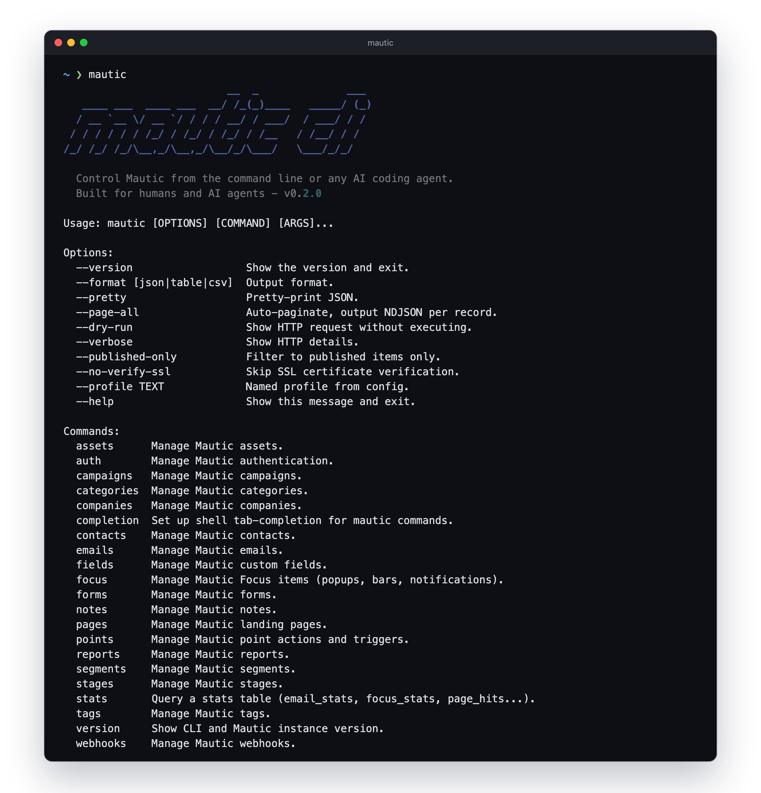

<div align="center">

# mautic-cli

**Control Mautic from the command line or any AI coding agent.**

[](LICENSE)
[](https://python.org)
[](https://mautic.org)

[Quick Start](#quick-start) &#183; [Commands](#commands) &#183; [Output Formats](#output-formats)



</div>

---

## How it works

Mautic-CLI runs on **your local machine** (laptop, desktop, CI server) and connects to your Mautic instance remotely via its REST API. You don't install anything on your Mautic server - you just need to enable the API there.

```
┌──────────────────┐         HTTPS          ┌──────────────────┐
│  Your computer   │ ────── API calls ─────▶│  Mautic server   │
│  (mautic-cli)    │ ◀──── JSON responses ──│  (any hosting)   │
└──────────────────┘                        └──────────────────┘
```

**On your Mautic server:** Go to Settings > API Settings, enable the API, and enable Basic Authentication (or set up OAuth2 credentials).

**On your machine:** Install the CLI and run `mautic auth setup` - see Quick Start below.

## What it does

| Category | Capabilities |
|----------|-------------|
| **Contacts** | List, search, create, edit, delete, points, segments, campaigns, activity |
| **Segments** | List, create, edit, delete, add/remove contacts |
| **Emails** | List, create, edit, send to contact, send to segment |
| **Campaigns** | List, create, edit, delete, clone (7+), add/remove contacts |
| **Forms** | List, create, edit that keeps what the patch leaves out, delete, delete fields, submissions, submission by ID, contact submissions, embed code |
| **Focus** | List, get, create, edit that keeps what the patch leaves out, delete, published JavaScript, views/clicks/submissions |
| **Stats** | Query any stats table (`email_stats`, `focus_stats`, `page_hits`...) with filters |
| **Companies** | List, get, create, edit, delete, add/remove contacts |
| **Notes** | List (per contact), get, create |
| **Stages** | List, set contact stage |
| **Assets** | List, get |
| **Tags** | List, create |
| **Categories** | List (with bundle filter), create |
| **Pages** | List, get |
| **Webhooks** | List, get, create, delete |
| **Fields** | List, create |
| **Reports** | List, get |
| **Points** | List actions, list triggers |
| **Auth** | Basic Auth, OAuth2 Client Credentials, multiple profiles |
| **Output** | JSON, colored tables, CSV, NDJSON streaming |

## Quick Start

No Python knowledge needed. The recommended installer, [uv](https://docs.astral.sh/uv/), handles everything including Python itself:

```bash
# 0. Install uv (one-time) — see https://docs.astral.sh/uv/getting-started/installation/
curl -LsSf https://astral.sh/uv/install.sh | sh      # macOS / Linux
# powershell -c "irm https://astral.sh/uv/install.ps1 | iex"   # Windows

# 1. Install mautic-cli (uv downloads the right Python automatically)
uv tool install mautic-cli
uv tool install --upgrade mautic-cli   # upgrade to latest

# 2. Authenticate (connects to your remote Mautic instance)
mautic auth setup

# 3. Use it
mautic contacts list --limit 5
mautic --format table emails list
```

<details>
<summary><strong>Alternative: install with pip</strong></summary>

If you already have Python 3.11+ installed and prefer pip:

```bash
pip install mautic-cli
```
</details>

🤖 **Using an AI agent?** Add the [skill](skills/mautic/SKILL.md) and let your agent handle the rest:

```bash
npx skills add bloomidea/mautic-cli
```

> *"list my mautic contacts"* / *"send email 5 to contact 42"* / *"export all contacts to CSV"*
>
> Works with [Claude Code, Cursor, Codex, Gemini, Windsurf, and 37+ agents](https://add-skill.org/).

## Commands

### Contacts

```bash
mautic contacts list --search "email:*@company.com" --limit 50
mautic contacts get 42
mautic contacts create --json '{"firstname":"Ana","email":"ana@example.com"}'
mautic contacts edit 42 --json '{"lastname":"Silva"}'
mautic contacts delete 42
mautic contacts add-points 42 10
mautic contacts add-to-segment 42 5
mautic contacts activity 42
```

### Segments

```bash
mautic segments list
mautic segments get 1
mautic segments contacts 1
mautic segments create --json '{"name":"Newsletter Q1","isPublished":true}'
```

### Emails

```bash
mautic emails list
mautic emails get 1
mautic emails send 1 --contact 42
mautic emails send-to-segment 1
```

### Campaigns

```bash
mautic campaigns list
mautic campaigns get 1
mautic campaigns contacts 1
mautic campaigns clone 1    # Mautic 7+ only
```

### Forms

```bash
mautic forms list
mautic forms get 1
mautic forms create --json @form.json
mautic forms edit 1 --json '{"name":"Updated Form"}'
mautic forms edit 1 --json '{"fields":[{"id":3,"label":"Your email"}]}' --dry-run
mautic forms fields delete 1 7 8        # delete fields 7 and 8 from form 1
mautic forms submissions 1              # list all submissions
mautic forms submissions 1 --offset 30 # paginate submissions
mautic forms submission 1 10           # get submission 10 from form 1
mautic forms contact-submissions 1 42  # submissions by contact 42 on form 1
mautic forms embed 1                    # show JS + iframe embed codes
mautic forms embed 1 --type js          # script tag only
mautic forms embed 1 --type iframe      # iframe only
mautic forms embed 1 --type html        # raw cached HTML
mautic forms delete 1
```

### Focus

```bash
mautic --format table focus list
mautic focus get 2
mautic focus create --json @focus.json
mautic focus edit 2 --css @focus.css --dry-run   # show what would change
mautic focus edit 2 --css @focus.css             # CSS lives in properties.content.css
mautic focus edit 2 --html @focus.html           # also switches htmlMode to html
mautic focus edit 2 --json '{"properties":{"timeout":6}}' --publish
mautic focus js 2                                # the script a visitor receives, without counting a view
mautic focus stats 2 --since 2026-10-15          # views, clicks, form submissions
mautic focus delete 2
```

### Edits that keep what the patch leaves out

A Mautic PATCH is not partial for every field. On a form, a PATCH without `postAction` sets it to `return` (the visitor stays on the form instead of the thank-you page), and the fields in the request are renumbered by their position, so sending one field moves it to the top. `forms edit` and `focus edit` therefore read the item, merge your JSON into it (objects key by key, fields and actions by `id`), send a complete payload and print what changed, from a GET before and a GET after:

```json
{"id": 5, "changes": [{"path": "fields[id=3].label", "before": "Email", "after": "Your email"}]}
```

A key the server changed without being asked shows up under `unexpected`, and a key you asked for that did not change (a typo, a name the API does not know) under `not_applied`, each with a warning on stderr. `--dry-run` prints the changes and sends nothing. In `forms edit`, a field or action without an `id` is added; set `order` on a field to move it to that position (1 is first). Publish dates go as `YYYY-MM-DD HH:MM` (`{"publishUp": "2026-10-20 09:00"}`); the ISO format a `get` returns is rejected.

### Stats

```bash
mautic stats                                    # tables and their columns
mautic stats email_stats --where email_id=296 --where 'date_sent>=2026-10-15' --limit 50
mautic --page-all stats focus_stats --where focus_id=2 > focus-2.ndjson
```

`--where` takes `=`, `!=`, `>`, `>=`, `<`, `<=`. Sort by `id` (`--order id:desc`): sorting a large table by a date times out.

### Companies

```bash
mautic companies list
mautic companies get 1
mautic companies create --json '{"companyname":"Acme Inc"}'
mautic companies edit 1 --json '{"companyname":"Updated"}'
mautic companies delete 1
mautic companies add-contact 1 42
mautic companies remove-contact 1 42
```

### Notes

```bash
mautic notes list --contact 42
mautic notes get 1
mautic notes create --json '{"lead":42,"type":"general","text":"Called, no answer"}'
```

### Stages & Points

```bash
mautic stages list
mautic stages set 42 1         # set contact 42 to stage 1
mautic points list
mautic points triggers list
```

### Assets, Tags, Categories

```bash
mautic assets list
mautic assets get 1
mautic tags list
mautic tags create --json '{"tag":"vip"}'
mautic categories list --bundle email
mautic categories create --json '{"title":"Q1 2026","bundle":"email"}'
```

### Pages, Webhooks, Fields, Reports

```bash
mautic pages list
mautic pages get 1
mautic webhooks list
mautic webhooks create --json '{"name":"New Lead","webhookUrl":"https://...","triggers":["mautic.lead_post_save_new"]}'
mautic webhooks delete 1
mautic fields list
mautic fields create --json '{"label":"Company Size","type":"number","group":"professional"}'
mautic reports list
mautic reports get 1
```

<details>
<summary><strong>All write commands accept JSON from inline, file, or stdin</strong></summary>

```bash
mautic contacts create --json '{"email":"test@example.com"}'
mautic contacts create --json @contact.json
cat contact.json | mautic contacts create --json @-
```
</details>

## Output Formats

**Table** - colored, aligned columns with total count (powered by [rich](https://github.com/Textualize/rich)):

```
                     Showing 5 of 274,528
id      firstname  lastname  email               points  dateAdded
66515   Lidia      Duarte    lidia@example.com    0       2024-09-27
26698   Claudia    Preis     claudia@example.com  0       2024-08-25
```

```bash
mautic --format table contacts list --limit 5
```

**JSON** (default) - full API response, pretty-printed in terminal:

```bash
mautic contacts list --limit 5
```

**CSV** - same key fields, pipe to file:

```bash
mautic --format csv contacts list > contacts.csv
```

**NDJSON** - one JSON object per line, auto-paginating through all results:

```bash
mautic --page-all contacts list | jq '.fields.all.email'
```

## Global Flags

Global flags go **before** the resource group:

```bash
mautic --format table --published-only emails list
```

| Flag | Description |
|----------|-------------|
| `--format json\|table\|csv` | Output format (default: json) |
| `--pretty` | Pretty-print JSON |
| `--page-all` | Auto-paginate, output NDJSON per record |
| `--dry-run` | Show HTTP request without executing |
| `--verbose` | Show HTTP request/response details |
| `--published-only` | Filter to published items only |
| `--no-verify-ssl` | Skip SSL certificate verification |
| `--profile <name>` | Use a named config profile |

## Authentication

### Interactive Setup

```bash
mautic auth setup    # Prompts for URL, method (basic/oauth2), credentials
mautic auth test     # Verify connection and detect Mautic version
```

Supports **Basic Auth** and **OAuth2 Client Credentials** grant.

### Environment Variables

```bash
export MAUTIC_BASE_URL=https://mautic.example.com
export MAUTIC_USERNAME=admin
export MAUTIC_PASSWORD=secret        # zsh: use $'p@ss!' if password contains !
```

### Profiles

Manage multiple Mautic instances with named profiles:

```bash
mautic auth setup           # Profile name: production
mautic auth setup           # Profile name: staging
mautic auth list            # Show all profiles
mautic auth delete staging  # Remove a profile

mautic --profile staging contacts list
```

<details>
<summary><strong>SSL / self-signed certificates (DDEV, local dev)</strong></summary>

```bash
# Per-command
mautic --no-verify-ssl contacts list

# Or save the preference during auth setup
mautic auth setup
# Skip SSL verification? (for self-signed certs) [y/N]: y
```
</details>

## Search Syntax

The `--search` flag passes through to [Mautic's native search](https://docs.mautic.org/en/5.x/contacts/search.html):

```bash
mautic contacts list --search "email:*@company.com"
mautic emails list --search "name:Newsletter"
mautic --published-only segments list    # uses is:published internally
```

## Shell Completion

Tab-completion for all commands, subcommands, and options:

```bash
mautic completion    # Shows install instructions for your shell
```

## License

[MIT](LICENSE)
